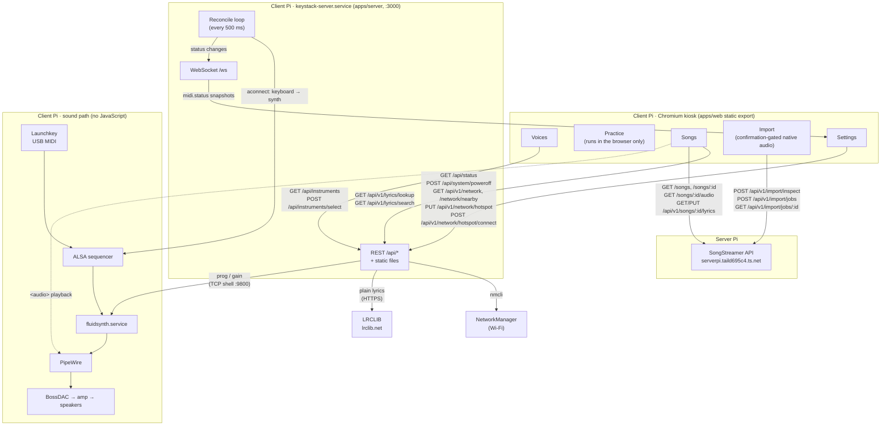

# KeyStack architecture

KeyStack is an appliance: power on the Pi and it boots straight into a
playable piano with a touchscreen UI. This doc covers how the pieces fit
together. For provisioning and shipping builds see
[deploy/README.md](../deploy/README.md); for UI tokens see
[design-system.md](design-system.md).

## Hardware and system environment

| Item | Value |
|---|---|
| Board | Raspberry Pi 5, Raspberry Pi OS (Debian 13 "trixie"), labwc Wayland desktop, auto-login as the normal user |
| Audio out | InnoMaker PCM5122 DAC HAT — ALSA card name **`BossDAC`**, device `hw:BossDAC,0` |
| Amplifier / speakers | Class D PAM8403/PAM8406 (5V) into 2x 4Ω / 3W |
| Keyboard | Novation **Launchkey Mini MK4 37** (USB, class-compliant) |
| Keyboard ALSA seq client | `'Launchkey Mini MK4 37'` — port `0 '… MIDI In'` is the playable one; port `1 '… DAW In'` is ignored |
| Synth engine | FluidSynth 2.4.4 — ALSA seq client `'FLUID Synth (<pid>)'`, port 0 |
| Soundfont | `/usr/share/sounds/sf2/FluidR3_GM.sf2` |
| Screen | Freenove 5" MIPI DSI, 800x480, touch |
| Status indicator | WS2812 RGB LED module (not driven by software yet) |
| Power | USB-C power bank (22.5W max), feeds the Pi and amp off the 5V rail |

Facts about this environment that the design depends on:

- **ALSA client numbers are not stable.** FluidSynth gets a new client id on
  every start, the keyboard can get a new one on replug, and card numbers can
  shuffle at boot. Everything is matched **by name**, never by number.
- **ALSA sequencer subscriptions live in the kernel.** Once created, MIDI
  flows keyboard → FluidSynth with no userspace process in between. The
  subscription disappears when either end goes away, so it has to be
  re-created.
- **PipeWire owns the DAC.** FluidSynth (the piano) and Chromium (the song
  player) are both PipeWire clients, mixed into one 48 kHz graph on
  `BossDAC`. Nothing else opens `hw:BossDAC,0` directly; doing so would lock
  PipeWire out and silence one of the two. The config lives in
  `deploy/audio/` and is installed by `deploy/audio.sh`.

## Signal path and processes

```
Launchkey ─USB─► ALSA sequencer ─► FluidSynth ──────────┐
                      ▲            (fluidsynth.service) │
                      │ creates the subscription        ├─► PipeWire ─► BossDAC ─► amp
                      │ (aconnect)                      │   48 kHz, quantum 256
                 apps/server                            │   [real-time, no JS]
                 (keystack-server.service)              │
                      │ REST + WebSocket, static export │
                      ▼                                 │
                 apps/web (Chromium kiosk) ─ <audio> ───┘
                                    ▲
                                    └─ streamed from the server Pi (SongStreamer)
```

### Who the kiosk talks to

The kiosk UI has two backends: the local server on the same Pi (same origin,
so `NEXT_PUBLIC_API_BASE_URL` is empty in production) for everything
device-facing, and SongStreamer on the server Pi
(`NEXT_PUBLIC_SONGS_API_BASE_URL`, over Tailscale Funnel) for the song
library and audio.



### Wi-Fi hotspot fallback

Settings has a Wi-Fi panel for when the Pi is away from home. The local server
manages exactly one NetworkManager profile, `keystack-hotspot` (for example an
iPhone's Personal Hotspot), through `nmcli` behind `NetworkPort`; every other
saved network is left alone. The profile autoconnects with priority `-10`,
below the default `0`, so the home network wins whenever both are in range and
the hotspot is joined on its own when home is gone. **Connect to hotspot**
forces the switch (an iPhone only broadcasts while its Personal Hotspot screen
is open, so the server rescans first and answers `NETWORK_NOT_FOUND` within
seconds). The password is write-only: `PUT /api/v1/network/hotspot` stores it
in NetworkManager and no response returns it. Only one change runs at a time;
a second one gets `409 BUSY`.

Three processes, each replaceable without the others. FluidSynth and the
server are systemd **user** units (`systemctl --user`), so nothing on the Pi
runs as root and deploying needs no sudo; lingering is enabled so they start
at boot rather than at login. The kiosk needs the desktop session, so labwc's
autostart launches it at login; deploys relaunch it.

### Timed lyrics boundary

SongStreamer owns the SQLite `song_lyrics` row and complete-document
validation. The browser editor keeps a timing session in memory, using the
single native audio element's direct `currentTime`; it sends a document only
after the final karaoke preview. The versioned document carries the song ID,
exact `audioSha256` (required for hashed recordings), language, ordered
lines/words, and integer millisecond timestamps. `PUT
/api/v1/songs/:id/lyrics` replaces the row atomically; failed validation or a
stale recording hash leaves the previous saved document available. The public
API has no auth layer, and the separate local/client Pi never talks to SQLite
directly.

The editor's **Find lyrics** tab gets the words from LRCLIB (lrclib.net)
through the local server, never from the browser directly. It first asks for
the exact recording (title, artist, album and the song's `duration`, which
LRCLIB matches within about two seconds), then falls back to a search the
user can refine with the on-screen keyboard. Only plain text is used:
`plainLyrics`, or `syncedLyrics` with every LRC timestamp removed when the
plain text is empty. All line and word timing is still done in the editor
against the exact recording. Picking a result goes straight to the text
preview; the text stays in the Paste tab for corrections. The lyrics source is
not saved with the document yet (see "Not built yet").

| Service | Role | If it dies |
|---|---|---|
| `pipewire` + `wireplumber` (Raspberry Pi OS user services) | Own the DAC; mix the synth and the browser | No sound from either. FluidSynth `Requires=pipewire`, so it restarts with it |
| `fluidsynth.service` | Turns MIDI into audio, as a PipeWire client | No piano sound until systemd restarts it (2s); the server then re-creates the route to the new client id. Songs keep playing |
| `keystack-server.service` | Wires keyboard → synth, owns state, serves the UI and API | **Sound keeps playing** — the route is in the kernel. On restart it finds the existing route and leaves it alone |
| `keystack-kiosk` (transient unit, started by `~/keystack/kiosk.sh`) | Waits for the server, then displays the UI | Nothing audible; restarted if it crashes, and re-fetches state |

## Principles

1. **JavaScript is never on the real-time audio path.** The Node backend only
   creates the wiring, tracks state, and talks to the UI.
2. **Separate processes.** The synth and the server are managed by systemd. `keystack-server` declares
   `Wants=fluidsynth.service`, not `Requires=`, so neither restart takes the
   other down.
3. **The backend is the source of truth.** The frontend fetches the current
   state, then follows pushed events. It holds no state of its own that a
   reload could lose.
4. **Hexagonal architecture.** Domain logic doesn't know about `aconnect`,
   Express, or WebSockets; adapters are swappable.
5. **Reconciliation over event-catching.** Hot-plug is handled by a loop that
   compares desired state with actual state, rather than by trying to catch
   every plug/unplug event. It is idempotent and self-healing.

## Repository

npm workspaces monorepo:

```
apps/
  server/     Node + TypeScript + Express + ws (bundled to dist/index.cjs)
  web/        Next.js static export — the kiosk UI
packages/
  shared/     Types shared by server and web: DTOs and pushed events
deploy/       systemd user units, labwc kiosk autostart, provision/sync scripts
```

`packages/shared` is the compile-time contract between the two apps. The
MIDI types are in `packages/shared/src/midi.ts`:

```ts
type MidiConnectionStatus = {
  keyboard: { present: boolean; name?: string }
  synth: { present: boolean; name?: string }
  routed: boolean        // keyboard MIDI In → synth port 0 subscription exists
  lastChangedAt: string  // ISO timestamp
}

type KeyStackEvent =
  | { type: "midi.status"; status: MidiConnectionStatus }
  | { type: "midi.keyboard.connected"; name: string }
  | { type: "midi.keyboard.disconnected" }
  | { type: "midi.route.established" }
  | { type: "midi.route.failed"; reason: string }
```

## Backend (`apps/server`)

```
src/
  domain/midi-connection/
    types.ts          SeqClient, SeqPort, SeqAddress
    matching.ts       pure: find keyboard port, find synth port, isRouted
    reconciler.ts     MidiConnectionReconciler — the core logic, ports only
  ports/
    SequencerPort.ts        list clients, connect
    EventPublisherPort.ts   publish a KeyStackEvent
    ClockPort.ts            now + schedule (so tests control time)
    LoggerPort.ts           info / warn / error
    SystemPowerPort.ts      power the machine off
    LyricsSourcePort.ts     exact lookup + search for plain lyrics
  adapters/
    alsa/AconnectSequencerAdapter.ts   SequencerPort via the `aconnect` CLI
    alsa/parseAconnectList.ts          pure parser for `aconnect -l`
    system/SystemctlPowerAdapter.ts    SystemPowerPort via `systemctl poweroff`
    ws/WebSocketEventPublisher.ts      EventPublisherPort, broadcasts to clients
    http/statusRoutes.ts               GET /api/status, /api/health
    http/systemRoutes.ts               POST /api/system/poweroff
    http/lyricsRoutes.ts               GET /api/v1/lyrics/lookup, /search
    lrclib/LrclibAdapter.ts            LyricsSourcePort via the LRCLIB API
  domain/lyrics-lookup/plainText.ts    pure: plain text, LRC timestamps removed
  config.ts           env-based config, validated at startup
  main.ts             composition root
```

### The reconciler

Desired state: *if a keyboard and a synth matching the config are both
present, the keyboard's MIDI In port is subscribed to the synth's port 0.*

Every `POLL_INTERVAL_MS`:

1. List sequencer clients (`aconnect -l`).
2. Keyboard port = first port whose client name starts with
   `KEYBOARD_CLIENT_PREFIX` and whose port name contains
   `KEYBOARD_PORT_MATCH`. Matching on the port name is what skips "DAW In".
3. Synth port = port 0 of the first client whose name starts with
   `SYNTH_CLIENT_PREFIX`.
4. If both exist and the keyboard port isn't already connected to the synth
   port, run `aconnect <keyboard> <synth>`.
5. If the resulting status differs from the previous one, store it and
   publish a full `midi.status` snapshot plus the specific events.

Properties:

- **No overlapping ticks** — the next tick is scheduled only after the
  current one finishes.
- **Never throws out of the loop** — a failing `aconnect -l` or `connect` is
  logged and retried on the next tick.
- **Idempotent** — a tick with nothing to do connects nothing and publishes
  nothing.
- **Quiet on repeated failures** — an identical error is logged, and
  `midi.route.failed` published, once rather than twice a second. The retry
  itself still happens every tick.
- **Timeouts** — every `aconnect` call is an `execFile` (no shell) with
  `ACONNECT_TIMEOUT_MS`.

Cases this one loop covers: keyboard unplugged and replugged, FluidSynth
restarted with a new client id, server restarted while a route already
exists, keyboard without synth, synth without keyboard.

### API

HTTP and WebSocket share one server on `PORT`, which also serves the static
frontend from `STATIC_DIR`.

| | |
|---|---|
| `GET /api/status` | `{ midi: MidiConnectionStatus }` |
| `GET /api/health` | `{ ok: true }` |
| `POST /api/system/poweroff` | Shuts the Pi down (`systemctl poweroff`). Returns `{ ok: true }`, or `{ ok: false, error }` |
| `GET /api/instruments` | `{ selected: InstrumentId, volume: 0-100 }`: the piano's current voice and volume |
| `POST /api/instruments/select` | `{ instrumentId }`. Switches FluidSynth's voice. `400` for an unknown id, `503` (with `error`) when the synth can't be reached; the selection only changes on success |
| `POST /api/instruments/volume` | `{ volume: 0-100 }`. Sets FluidSynth's master gain (100 = gain 0.8; the default 63 matches the unit's `-g 0.5`). Same errors as above |
| `GET /api/v1/lyrics/lookup?title=&artist=&album=&duration=` | `{ match: LyricsCandidate \| null }`: LRCLIB's record for this exact recording. `album` and `duration` (seconds) are optional |
| `GET /api/v1/lyrics/search?q=` | `{ results: LyricsCandidate[] }`, at most 20, plain text only |
| WebSocket `/ws` | Sends a `midi.status` snapshot on connect, then broadcasts every `KeyStackEvent` as JSON |

The lyrics routes answer `400 INVALID_REQUEST` for missing or over-long
fields, `504 LYRICS_SOURCE_TIMEOUT` when LRCLIB takes longer than
`LRCLIB_TIMEOUT_MS`, and `502 LYRICS_SOURCE_UNAVAILABLE` /
`LYRICS_SOURCE_INVALID_RESPONSE` otherwise, as `{ error: { code, message } }`.
They are read-only and safe to retry; "no match" is a `200` with an empty
result.

A full snapshot accompanies every change, so a client that missed an event
still converges on the right state.

The power-off route only accepts `Content-Type: application/json`. Browsers
can't send that cross-origin without a CORS preflight, which the server
refuses, so a web page open on another device on the network can't switch
the Pi off. No sudo is involved: logind lets the user of the active desktop
session power off.

The power-off and instrument `POST` routes all require
`Content-Type: application/json` for that reason.

### Voices and volume

`domain/instruments` maps each voice to a General MIDI program in
FluidR3_GM, bank 0:

| Voice | Program | FluidR3_GM preset |
|---|---|---|
| `piano` | 0 | Yamaha Grand Piano |
| `electric-piano` | 4 | Rhodes EP |
| `stevie-wonder-piano` | 7 | Clavinet |

`adapters/fluidsynth/FluidSynthShellAdapter.ts` sends `prog <channel>
<program>` to every channel except 9 (General MIDI drums), so the voice
follows whatever channel the keyboard sends on, and `gain <n>` for volume,
over FluidSynth's command shell (`SYNTH_SHELL_PORT`, the unit's
`-o shell.port=9800`). Each call opens a connection, sends `quit`, and
treats an `unknown command`/`error` line as a failure.

FluidSynth forgets both settings when it restarts. The server watches the
`midi.status` snapshots it publishes; when a new synth client name appears,
it re-applies the selected voice and volume. The selection lives in memory:
a server restart goes back to the piano at volume 63 (and re-applies that).

### Configuration

Environment variables, validated at startup — the server exits with a clear
message on an invalid value.

| Var | Default | Purpose |
|---|---|---|
| `PORT` | `3000` | HTTP/WS port (`npm run dev:server` uses 4000) |
| `STATIC_DIR` | `../web/out` | Static frontend to serve |
| `KEYBOARD_CLIENT_PREFIX` | `Launchkey` | Keyboard client name prefix |
| `KEYBOARD_PORT_MATCH` | `MIDI In` | Substring identifying the playable port |
| `SYNTH_CLIENT_PREFIX` | `FLUID Synth` | Synth client name prefix |
| `POLL_INTERVAL_MS` | `500` | Reconcile interval |
| `ACONNECT_TIMEOUT_MS` | `2000` | Timeout per `aconnect` call |
| `SYNTH_SHELL_PORT` | `9800` | FluidSynth's command shell, used to switch voices and volume |
| `LRCLIB_BASE_URL` | `https://lrclib.net` | Lyrics source for the editor's Find tab |
| `LRCLIB_TIMEOUT_MS` | `8000` | Timeout per LRCLIB request |
| `CORS_ORIGIN` | unset | `Access-Control-Allow-Origin` for `/api`; only needed in dev, where `next dev` is a different origin |

To use a different keyboard, set `KEYBOARD_CLIENT_PREFIX` and
`KEYBOARD_PORT_MATCH` to match its names in `aconnect -l`.

## Frontend (`apps/web`)

A static Next.js export; it has no server-side code of its own. The shell
(`components/app-shell.tsx`) is a side rail linking the five screens:

| Route | Screen |
|---|---|
| `/`, `/instruments` | Voices: voice cards (`/` renders the same page, since the static export can't redirect) |
| `/scales`, `/scales/chromatic` | Practice: routine list and the chromatic trainer |
| `/songs` | Song library and player |
| `/import` | YouTube search and preview, inspection, metadata confirmation, and native AAC-LC import status |
| `/settings` | Power off, hardware status, and the banner |

Feature modules under `app/modules/` use the same layering as the backend,
in lighter form:

- `midi-connection/` — `adapters/midi-status-client.ts` does
  `GET /api/status`, then opens `/ws` and follows `midi.status` snapshots,
  reconnecting with backoff (0.5s doubling to 5s) and re-fetching on each
  attempt. `components/MidiStatusPanel.tsx` shows keyboard / synth / route on
  the Settings page.
- `system-power/` — the power button on the Settings page. It opens a
  confirmation dialog (`components/ui/alert-dialog.tsx`) and, on confirm,
  calls `POST /api/system/poweroff`.
- `basic-piano-instruments/` — the voice picker and piano volume
  (`core/`, `adapters/`, `components/`). It reads `GET /api/instruments`
  on load, so the page shows what the synth is actually on, and draws each
  voice with `VoiceArt` (inline SVG, no image files).
- `song-player/` — the `/songs` library and player, a client of the
  SongStreamer API on the cloud/server Pi (contract in
  [backend-endpoints.md](../backend-endpoints.md), types in
  `keystack-shared`). `adapters/songstreamer-client.ts` calls `GET /songs`
  and `GET /songs/:id` on `NEXT_PUBLIC_SONGS_API_BASE_URL` and validates the
  payloads. `adapters/lyrics-lookup-client.ts` calls the local server's
  `/api/v1/lyrics/*` routes for the editor's `components/LyricsFinder.tsx`. `components/SongPlayerProvider.tsx` owns the app's single
  `HTMLAudioElement`, mounted in the root layout so playback continues
  across routes; its `src` is `/songs/:id/audio` and the browser streams it
  with native Range requests. Screens use hash routing (`#/` list,
  `#/songs/<id>` player) so deep links work on the static export. `core/`
  holds the pure seek/clamp and time-format logic.

- `onscreen-keyboard/` — KeyStack's own touch keyboard, mounted once in the
  root layout. It opens for any focused text field, types through the field's
  normal input events (so React `onChange` works unchanged), and publishes its
  height as `--osk-height` so the app and fixed panels end above it. Editing
  logic in `core/` is pure and unit-tested; `NEXT_PUBLIC_ONSCREEN_KEYBOARD`
  (`on`/`off`/`auto`) controls it. It exists because squeekboard cannot draw
  above the fullscreen kiosk on labwc.
- `song-import/` — the public YouTube import kiosk. It calls SongStreamer for
  metadata inspection, requires editable title/artist/optional album
  confirmation before creating a job, persists the active job ID across a
  refresh, locks navigation while the server downloads/verifies/publishes, and
  invalidates the Songs cache after completion. It never talks to SQLite or
  device hardware directly.

The scale trainer, fingering table and metronome run entirely in the
browser.

## Testing

`npm test` runs the server's Vitest suite, none of which touches ALSA:

- **Parser** — real `aconnect -l` output from the device (unrouted and
  routed fixtures), plus empty output, unknown lines, connection suffixes
  like `[real:0]`, padded port names.
- **Matching** — keyboard / synth / route detection, including ignoring the
  DAW In port.
- **Reconciler** — an in-memory fake `SequencerPort`, a spy publisher and a
  fake clock, covering each case listed above plus `connect` and
  `listClients` failures.
- **Lyrics lookup** — LRC timestamp removal, the LRCLIB adapter against a
  stubbed `fetch` (query, User-Agent, 404 as no match, malformed records,
  timeouts and errors), and the routes' validation and error mapping. The
  fixtures use invented lyrics only.

## Not built yet

- Remembering the voice and volume across server restarts
- A native ALSA binding or udev triggers in place of polling `aconnect`
- Other engines behind a `SoundEngine` port (sfizz, Pianoteq)
- Reading MIDI notes in the backend for UI features such as chord detection
- Driving the WS2812 status LED
- Saving where lyrics came from (`source: "lrclib"` and its record id) with the
  lyrics document; this needs a SongStreamer contract and schema change
